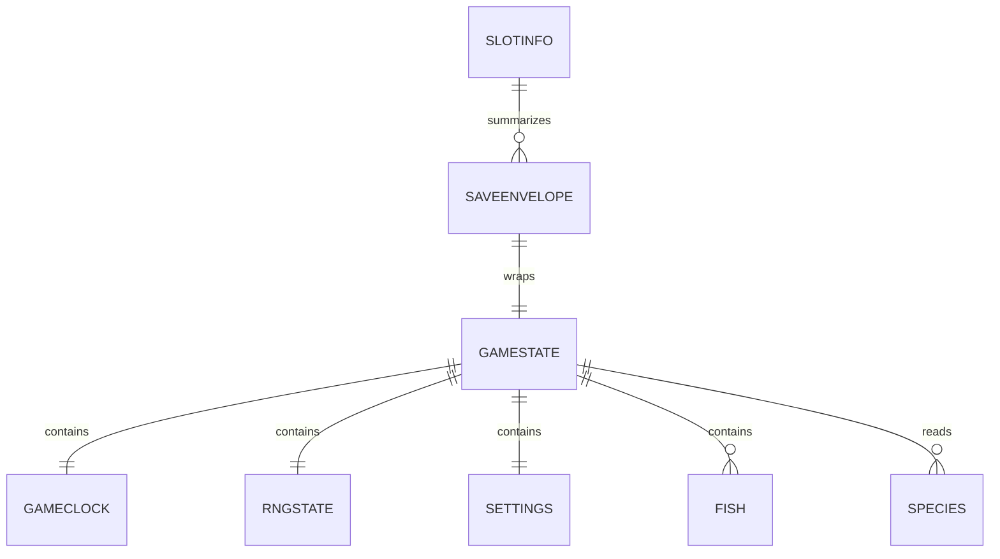

# Functional Spec — u1-sim-foundation

> Upstream: `unit-of-work.md` (U1), `unit-of-work-story-map.md` (US9.1–US9.3, US10.1, US10.2, US11.1), `stories.md`, `requirements.md` (FR9–FR11, NFR3, NFR4), `components.md` (Clock, SpeciesCatalog, Persistence), `contract-summary.md` (C1–C6), `entities.md`, `rules.md`. Implements US9.1, US9.2, US9.3, US10.1, US10.2, US11.1.

## Workflows

### W1 — Boot and bootstrap (composition root lives in U7; kernel ops here)

1. U7 constructs the store from U1's factory with a fixed seed (new game) or a migrated save payload.
2. U1 validates species catalogue (BR5.1), initializes `RngState` (`seed` mirrors state seed), clock at day 1 hour 8, empty collections.
3. Each sim unit's `register(registry)` runs; U1 checks for duplicates (BR4.2, dev-boot throw).
4. U1 runs the registration-exhaustiveness test gate (registered set equals `keyof CommandMap`).
5. App mounts; autosave timer starts (~30 s).

### W2 — Fixed tick (FR10.2, BR1.1, BR4.1)

1. Real time accumulates into queued game-hour ticks at pause/x1/x2/x4 (BR1.2).
2. For each tick: run phases feeding → water → fish → breeding → commerce → notify (each system's `run(ctx)`; `catchUp` false). Cross-unit read timing (e.g. bioload seeing start-of-tick fish mass) follows C2; U2's design owns the lag detail.
3. Run the C4 drain: apply notification mapper → deliver batch to subscribers → clear buffer.
4. Bump version once; mark dirty. Repeat for each queued tick; ticks never partial.

### W3 — Command dispatch (BR3.1)

1. U7 dispatches `settings.update` / `clock.setSpeed` / `clock.setPaused` (Q1-A) between ticks.
2. Bus resolves handler; unknown type returns UNKNOWN_COMMAND, nothing changes.
3. Handler validates → on failure returns `{ ok: false }` (no event, no bump); on success mutates, appends events, drains, bumps once, marks dirty (Q5-A).

### W4 — Autosave and manual slots (US9.1, US9.2; BR6.1, BR6.2)

1. Autosave fires (~30 s or key event, even while paused): serialize → write oldest auto slot → read-back verify → swap active; on failure retry once → localStorage → warn + disable until next success.
2. `saveToSlot(name)`: unbounded named slots (Q4-A); overwrite replaces.
3. `listSlots()` returns `SlotInfo[]`; `load(ref)` replaces state; `deleteSlot(ref)` removes.

### W5 — Export / import (US9.3; BR6.2, BR6.3)

1. `exportFile()` serializes the envelope; no slot written (Q4-A).
2. `importFile(text)`: parse → shape (including the clock invariant `paused == (speed == 0)`, else INVALID_SHAPE) → version → checksum → migrate → rollback check; any failure returns the named `SaveErrorCode` with current save untouched; success replaces state alongside (never over) the current save until all steps pass.
3. `deleteSlot(ref)`: missing slot returns SLOT_NOT_FOUND with nothing changed; deleting any existing slot removes it; the loaded in-memory state is never touched by a slot delete (BR6.4).

### W6 — Offline catch-up (US11.1; BR7.1)

1. On return, compute absence; cap at 8 game-days (192 ticks).
2. Run the same pipeline with `catchUp=true`, no rendering; U3 suppresses lethal transitions (protected critical state, floor 10).
3. Emit `whileYouWereAway` aggregated event; U7 shows the summary (hatched/matured/diedOfOldAge/ordersExpired); set the clock to `speed 0` + `paused true` (stopped) and discard remaining time.

## State machines

### GameClock speed

```
paused --setSpeed(1|2|4)--> running
running --setSpeed(0) / setPaused(true)--> paused
running --setSpeed(1|2|4)--> running (rate changes)
paused --setPaused(false)--> running (speed 1, always; unpause never restores a prior speed)
```

Invariant: `paused == (speed == 0)` (BR1.3).

### Slot lifecycle

```
active --saveToSlot/ autosave--> written --read-back--> verified --swap--> active
written --failure--> retry --> localStorage --> disabled-until-success
import --any-check-fails--> rejected (current save untouched)
```

## Entity-relationship view (derived from `entities.md`)



## Rules summary (derived from `rules.md`)

BR1.1 fixed tick + phase order; BR1.2 speed/pause queuing; BR1.3 mirror invariant; BR2.1 seeded determinism; BR3.1 U1 command validate-then-mutate; BR4.1 phase-order execution; BR4.2 exhaustiveness check; BR5.1 species validation; BR6.1 autosave rotation; BR6.2 slots/export/import; BR6.3 migrations + rollback; BR6.4 slot-delete contract; BR7.1 capped catch-up with neglect protection.
