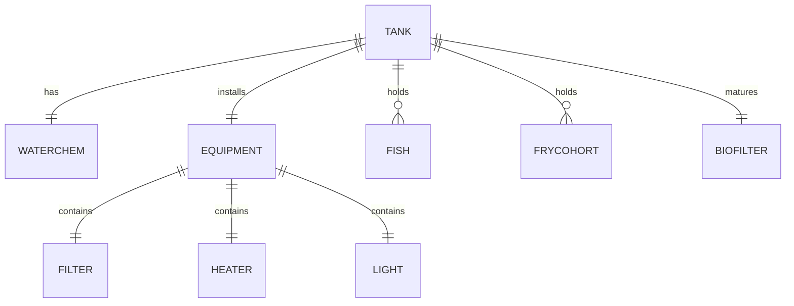

# Functional Spec — u2-tank-water

> Upstream: `entities.md`, `rules.md` (BR8.1–BR9.3), `unit-of-work.md`, `unit-of-work-story-map.md` (US1.2 → U2; US1.3 → U2 implementing, U6 money), `stories.md` (AC1.2.1–AC1.3.2), `requirements.md` (FR1.2, FR1.3, FR4.1, FR4.2), `components.md` (TankEnvironment), `contract-summary.md` (C1–C4). Answers from `functional-design-questions.md` (Q1–Q6, summary `Looks correct`).
> Implements US1.2 and US1.3. Continues U1's workflow numbering at W7.

## Workflows

### W7 — Water tick (US1.2; BR8.1, BR8.2, BR8.3, BR8.5, BR8.6)

Constants (normative; tuned for ~20L/60L/150L tanks): WASTE_RATE = 0.02 waste per bioload-unit per tick; WASTE_PER_PORTION = 2.0 waste per leftover portion; NITRATE_RATIO = 0.5; MATURITY_PER_TICK = 1/240 (~10 game-days); TEMP_DRIFT = 0.2; activity from satiety = 1.2 (≥70) / 1.0 (30–69) / 0.8 (<30) — U2-local default until U3 defines its scale; filter conversionRate by level = 2 / 5 / 9; cohort load = count × 0.05; bands on max(waste, nitrate): good <40, fair 40–69, poor ≥70.

1. Feeding phase has run (U4 deposited any leftover waste via BR9.3).
2. Recompute `bioload` = Σ over fish in tank of `adultSizeCm × activity` + Σ over cohorts of `count × 0.05`.
3. `waste = min(100, waste + bioload × WASTE_RATE)`; while `bioload > volumeL`, add at double rate (overcrowding, BR8.6).
4. Convert: `c = conversionRate × maturity`; `waste -= min(waste, c)`; `nitrate = min(100, nitrate + converted × 0.5)`.
5. Mature: `maturity = min(1, maturity + 1/240)` (BR8.3).
6. Temperature: drift toward 26 (heater) or 22 (ambient) at 0.2/tick, clamp 10–35.
7. Latches: band = current band; overcrowd episode opens (emit `tankOvercrowded`, set latch) on newly exceeding capacity and re-arms when back within; poor band newly entered emits `fishSick { cause: 'waterQuality' }` per fish in tank; temperature episode (any fish tempFit < 0.5, latch clear) emits `fishSick { cause: 'temperature' }` for those fish; then set `prevQualityBand` to the current band and update both latches every tick. Late arrivals into an open episode or sustained poor band emit nothing.
8. U3's fish system (later phase, same tick) reads `waterQuality` and `tempFitFor` and applies health/stress; U6's mapper notifies on `fishSick` / `tankOvercrowded` (aggregated — see coordination notes).

### W8 — Feeding deposits waste (BR8.1 via BR9.3)

1. U4's feed path (command or auto-feeder) computes leftover portions from its own stock rules.
2. It adds `leftover × WASTE_PER_PORTION` directly to `tank.water.waste`, clamped to 100 (the one documented cross-unit write).
3. No event for the deposit itself; the next W7 shows the rise, and `overfed { wasteDelta }` (U4's event) narrates it.

### W9 — Water change command (US1.2; BR8.4)

1. Dispatch `tank.waterChange { portionPct }`, bounds 10 and 50 inclusive.
2. Reject INVALID_QUANTITY outside 10–50; reject INSUFFICIENT_FUNDS below `ceil(volumeL × portionPct/100 / 2)` $FISH.
3. `waste ×= (1−p)`, `nitrate ×= (1−p)`; deduct fee; emit `waterChanged { wasteDelta }` + `moneyChanged { delta: −fee, balance }`; the bus bumps version once and marks dirty.

### W10 — Equipment and tier purchase (US1.3; BR9.1, BR9.2, AC1.3.1)

1. Dispatch `tank.buyEquipment { kind: 'filter' | 'heater' | 'light' | 'autoFeeder', level }` or `tank.upgradeTier { tier }`. Valid levels: filter 1–3, heater 1 only (installed true), light 1–3, autoFeeder 1 only.
2. Reject UNKNOWN_ENTITY (unknown kind/level, incl. heater or autoFeeder level ≠ 1), NOT_AVAILABLE (unlock id absent: `equipment.filter2`, `equipment.filter3`, `equipment.heater`, `equipment.light2`, `equipment.light3`, `equipment.autofeeder`, `tier.2`, `tier.3` — awarded by U6 progression), INSUFFICIENT_FUNDS.
3. Install / set tier + volumeL (20/60/150); filter-level change resets maturity (BR8.3), tier upgrade keeps it; deduct; emit `equipmentUpgraded { equipment }` or `tierUpgraded { tier }` + `moneyChanged { delta: −price, balance }`; the bus bumps version once and marks dirty.
4. Shop prices (U2 data, $FISH): filter L2 150 / L3 400; heater 120; light L2 80 / L3 200; autoFeeder 150; tier 2 upgrade 300 / tier 3 upgrade 800. Starter kit (tier 1, filter L1, no heater, no feeder, light L1) is free with a new save.

### W11 — Heater keeps tropicals (US1.3; BR8.5, AC1.3.2)

1. Species with `tempRangeC` (Q6-A catalogue field) compare tank `tempC` each fish tick (U3 reads `tempFitFor(state, speciesId)`).
2. Heater installed ⇒ 26°C holds most tropical ranges; no heater ⇒ 22°C ambient stresses them (U3 health effect; the `fishSick` cause is `'temperature'` for temp-driven episodes, `'waterQuality'` for dirty-water episodes).

## State machines

**Biofilter:** `new (0)` → `cycling (0–1)` → `mature (1)`; any filter-level change returns to `new`. Maturity never decreases otherwise.

**Water band:** `good` ↔ `fair` ↔ `poor` from `max(waste, nitrate)`; transitions are pure functions of the numbers, and `prevQualityBand` persists only the last band for edge-triggering.

## Command catalogue (U2 augments U1's CommandMap)

| Command | Payload | Result | Errors |
|---|---|---|---|
| `tank.waterChange` | `{ portionPct: number }` | `{ fee, waste, nitrate }` | INVALID_QUANTITY, INSUFFICIENT_FUNDS |
| `tank.buyEquipment` | `{ kind: 'filter' \| 'heater' \| 'light' \| 'autoFeeder', level: number }` | `{ kind, level, price }` | UNKNOWN_ENTITY, NOT_AVAILABLE, INSUFFICIENT_FUNDS |
| `tank.upgradeTier` | `{ tier: 2 \| 3 }` | `{ tier, volumeL, price }` | INVALID_QUANTITY, NOT_AVAILABLE, INSUFFICIENT_FUNDS |

## Event catalogue (U2 augments U1's SimEventMap; catalogue entries in C4 stand)

| Event | Fields | When |
|---|---|---|
| `waterChanged` | `{ wasteDelta: number }` | W9 success (wasteDelta is the reduction, positive) |
| `equipmentUpgraded` | `{ equipment: string }` | W10 equipment success, e.g. `"filter:2"`, `"heater:1"` |
| `fishSick` | `{ fishId: FishId, cause: 'waterQuality' \| 'temperature' }` | W7 band newly poor (per fish), or temp episode opening (fit < 0.5 fish) |
| `tierUpgraded` | `{ tier: number }` | **New additive variant**: W10 tier success |
| `tankOvercrowded` | `{ bioload: number, capacity: number }` | **New additive variant**: W7 newly over capacity |

## Selectors (U2-owned, read by U3/U6/U7)

- `tankWater(state): WaterChemistry` — the numbers for panels.
- `waterQuality(state): number` — `100 − max(waste, nitrate)`; U3 health input, U7 green/yellow/red.
- `capacity(state): number` — `volumeL`; U6's TANK_FULL check.
- `projectedBioload(state, adultSizeCm): number` — `bioload + adultSizeCm × 1.0`. The purchase-time check: an unstocked fish has no satiety, so default activity 1.0. U6's `buyFish` and every later stocking path (e.g. U5 cohort graduation) call this and refuse TANK_FULL on breach — never a head-count comparison (supersedes the C3 illustrative example; annotated there).
- `bioloadOf(state): number` — recomputed cache reader; U7 stocking meter.
- `tempFitFor(state, speciesId): number` — 1 inside `tempRangeC` (or 20–28 when absent), else `max(0, 1 − 0.1 × degrees-outside)`.

## Coordination notes

- **U6**: awards unlock ids `equipment.filter2/3`, `equipment.heater`, `equipment.autofeeder`, `equipment.light2/3`, `tier.2/3` through progression; calls `projectedBioload` for every stocking check (never head-count); maps `fishSick` → warn/critical notification (focus fish; cause tells dirty water from cold), `tankOvercrowded` → warn, `waterChanged`/`tierUpgraded` → info. Mapper MUST aggregate per-tick `fishSick` bursts (one notification per tick summarizing the count — a 100-fish tank emits 100 events on a band flip) and cap the queue; emission itself is unbounded by design. `moneyChanged` reuse by U2 needs no mapper change.
- **U1 (data completion)**: add optional `tempRangeC: [min, max]` to species entries that need it (tropicals ~24–28); tolerant species omit it. Additive per C5.
- **U3**: reads `waterQuality` + `tempFitFor`; owns all health/stress effects including the FR4.2 temperature/pH-driven drops (pH itself stays unmodeled — temperature-only in the MVP per Q1-A).
- **U4**: the BR9.3 waste write is its only write into Tank; everything else U4 owns stays on FoodItem.

## Rules summary

BR8.1 waste accumulates from bioload + feeding; BR8.2 filter converts waste → nitrate at capacity × maturity; BR8.3 new filters cycle ~10 game-days, replacement resets; BR8.4 water changes dilute 10–50% for a volume fee; BR8.5 heater holds 26°C vs 22°C ambient with catalogue ranges; BR8.6 bioload-vs-volume capacity with warn-then-crash and TANK_FULL; BR9.1 equipment purchase is funds + unlocks with atomic deduct; BR9.2 tier upgrades carry equipment; BR9.3 selectors out, one documented waste write in.
