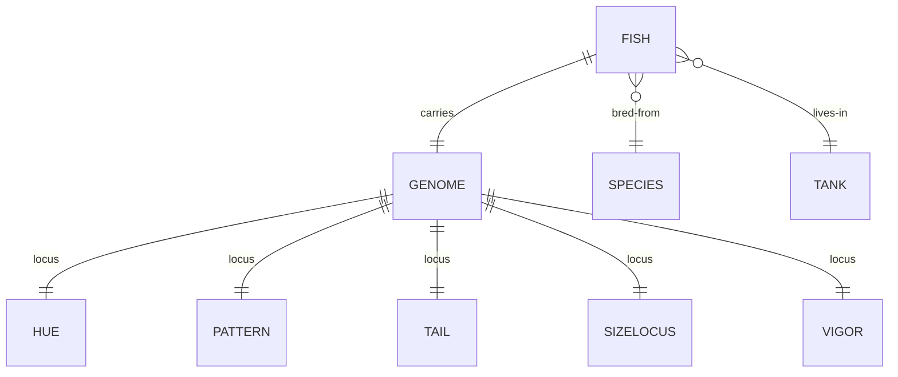

# Functional Spec — u3-fish

> Upstream: `entities.md`, `rules.md` (BR10.1–BR11.3), `unit-of-work.md`, `unit-of-work-story-map.md` (US2.1, US2.2, US4.1–US4.3 → U3; US11.1 neglect protection), `stories.md` (AC2.1.1, AC2.2.1, AC4.1.1, AC4.2.1, AC4.3.1), `requirements.md` (FR2.2, FR4.1–FR4.3), `components.md` (FishPopulation), `contract-summary.md` (C1–C4, amended C2 exception + C3 projectedBioload), U2 design (selectors, episode causes, U2-local activity map — ratified below). Answers from `functional-design-questions.md` (Q1–Q7, summary `Looks correct`).
> Implements US2.1 (spawn side), US2.2, US4.1–US4.3, and the U3 side of US11.1. Continues workflow numbering at W12. Owns no commands: U3 acts through its fish-phase system plus pure factories called by U6 (buying) and U5 (inheritance).

## Workflows

### W12 — Fish tick (US4.1–US4.3; BR10.1–BR10.6)

Constants (normative): satiety decay 100/48 per tick; regen +2 (+vigor); stressor weights hunger −2 / water −3 / temp −2 / crowding −1; sick < 40, critical < 15; activity 1.2 / 1.0 / 0.8 by satiety ≥70 / 30–69 / <30 (ratifies U2's W7 default as the shared scale — one table, two readers).

1. Water phase has run (U2); feeding phase ran before it (U4).
2. `ageDays += 1/24`.
3. Growth (BR10.1): `sizeCm += (adultSize × sizeMult × (stunted ? 0.8 : 1) − sizeCm) × rate × condition`, rate from maturityDays, condition from satiety × waterQuality × tempFit × crowdFactor.
4. Satiety decay (BR10.2).
5. Health (BR10.3): regen if fed-and-clean, minus active stressors, clamp; set `stress`.
6. Stage (BR10.5): juvenile→adult at maturityDays (`fishMatured { stage: 'adult' }`, mature = true); adult→senior at 70% lifespanDays (`fishMatured { stage: 'senior' }`).
7. Death (BR10.4, BR10.6): health 0 → remove + `fishDied` (starvation iff hunger active else waterQuality); ageDays ≥ lifespanDays → remove + `fishDied { cause: 'oldAge' }`. Skip entirely while `catchUp` (W14).
Overcrowding predicate (shared with U2): `overcrowded ≡ bioload > volumeL`. Stressor/episode thresholds differ by intent: U3 stressors start at tempFit < 0.7 and quality < 40 so decline begins early and visibly; U2's `fishSick` episodes open at tempFit < 0.5 and the poor band (≥70) so notifications fire only on steep decline. The in-between bands are tooltip-only by design — U7 reads `growthCondition`/`healthOf` to name the cause before any episode opens.
8. U5's breeding system (later phase, same tick) reads stage/health/satiety; U6's commerce system refreshes `value`; U6's mapper notifies on `fishDied` / `fishMatured`.

### W13 — Spawn on buy (US2.1, US2.2; BR11.1, BR11.2)

1. U7 dispatches U6's `commerce.buyFish { speciesId }`.
2. U6 checks `projectedBioload(state, adultSizeCm) ≤ capacity` else TANK_FULL; checks funds else INSUFFICIENT_FUNDS.
3. U6 calls U3's `spawnFish(state, species, rng)` — pure: sex 50/50, size 50–70% of adult, genome rolled, parents null, value = buyPrice.
4. U6 deducts, inserts the Fish, emits `fishBought` + `fishSpawned` + `moneyChanged`; bus bumps version once.
5. AC2.1.2 (browse all 30 species): the listed set is the valid catalogue per BR11.4 (U3 rule); the 30-count itself closes with U1 data completion plus U7's rendering of the list.

### W14 — Catch-up protection (US11.1; BR10.7)

1. U1 advances up to 192 ticks with `catchUp = true` through the same pipeline (W12 runs each tick).
2. After the health update, clamp to floor 10; skip health-driven death removals and never emit `fishDied` for starvation/waterQuality; old-age removals at or past lifespanDays still proceed and count into `whileYouWereAway.diedOfOldAge` with no per-event notify.
3. Fish in sustained poor water land at health 10 with active `fishSick` episodes already notified; the U7 "while you were away" summary covers the span. Births/graduations during catch-up follow their normal rules (U5).

### W15 — Genome inheritance helper (U5 coordination; Q7-B)

1. U5 calls U3's pure `inheritGenome(rng, sire, dam)`: per locus, one allele from each parent via rng; no mutation in the MVP (stunting is U5's size-penalty, not a gene change).
2. Phenotype derivation (shared readers): locus value = allele sum; sizeMult 0.95/1.0/1.05; vigor adds +0/+0.5/+1 regen; hue/pattern/tail feed U7 rendering and U6's colour/rarity factors.
3. `genomeQuality(genome)` = premium-allele count / 10 — U6's genetics price input.

## State machines

**Stage:** `juvenile` → `adult` → `senior` → removed (`oldAge` at lifespanDays, or killed at health 0). Transitions are age- or health-driven, never manual; `mature` mirrors adult/senior.

**Health bands:** `healthy (≥40)` ↔ `sick (<40)` ↔ `critical (<15)` → dead at 0. Bands are pure functions of the number; U6 enforces unsellable below 40, U5 gates breeding on the same line.

## Command catalogue

None owned. U3's transactional surface is the two pure factories (`spawnFish`, `inheritGenome`) called by U6/U5 handlers. Any future fish command (rename, cull) is post-MVP.

## Event catalogue (U3 variants from the C4 target catalogue; no new variants)

| Event | Fields | When |
|---|---|---|
| `fishSpawned` | `{ fishId, speciesId, tankId }` | W13 buy (via U6 handler); U5 births use `fryHatched` instead |
| `fishDied` | `{ fishId, cause: 'oldAge' \| 'starvation' \| 'waterQuality' }` | W12 death; never while catchUp (W14) |
| `fishMatured` | `{ fishId, stage: 'adult' \| 'senior' }` | W12 stage transitions |

`fishSick` stays U2's variant (poor-band and temperature episodes); U3's health drops read the same numbers, so no duplicate cause logic. Death by temperature maps to `waterQuality` (environmental); the `fishSick { cause: 'temperature' }` episode already told the story.

## Selectors and factories (U3-owned)

- `fishById(state, id)`, `fishInTank(state, tankId)`, `healthOf(state, id)`.
- `growthCondition(state, fish)` — the W12 condition product, shared reader for U7 tooltips.
- `genomeQuality(genome)` — premium count / 10 for U6 pricing.
- `spawnFish(state, species, rng): Fish` (BR11.1) — called by U6.
- `inheritGenome(rng, sire, dam): Genome` (W15) — called by U5.
- Activity scale (satiety → 1.2/1.0/0.8) is the shared U2/U3 table; U2 computes bioload with it, U3 documents it — a single definition referenced from both specs.

## Coordination notes

- **U2**: activity scale ratified as shared; `waterQuality` + `tempFitFor` are U3's per-tick inputs; `projectedBioload` default activity 1.0 matches unstocked fish (no satiety yet) — consistent by construction.
- **U4**: owns all satiety writes (feed command + auto-feeder); feeding portions should restore satiety proportionally and record leftovers for the waste path (U4 detail). Starvation deaths name U4-visible causes.
- **U5**: calls `inheritGenome`; reads stage/health/satiety for breeding gates (mature, health ≥ 40, satiety threshold — U5 detail); cohort graduation creates Fish records via the same field rules as BR11.1 (sex 50/50, parents set, genome from the cohort pool) and must call `projectedBioload` first.
- **U6**: owns `commerce.buyFish` per W13; refreshes `Fish.value` from the price formula each commerce tick (documented cache write, ratified in U6 design); enforces sick-unsellable at health < 40; maps `fishDied` → info (with cause) and `fishMatured` → info.
- **U1**: no catalogue change needed (species fields already cover size/lifespan/maturity/diet; `tempRangeC` was the U2 add).
- **C2 amendment (second half)**: the allowed-exception line now reads "U4's feeding path may write `tank.water.waste` and `Fish.satiety`" — satiety added alongside waste in the same edit.

## Rules summary

BR10.1 saturating per-species growth scaled by care; BR10.2 satiety decays over ~2 days, feeding restores; BR10.3 regen-minus-weighted-stressors with sick/critical lines; BR10.4 death at 0 with dominant-stressor cause; BR10.5 age-driven maturation with events; BR10.6 exact-lifespan old-age death; BR10.7 catch-up neglect floor-10 with old age proceeding; BR11.1 pure spawnFish factory; BR11.2 U6 buy flow with bioload guard; BR11.3 selectors/factories out, two documented writes in; BR11.4 sale listing equals the valid catalogue.
