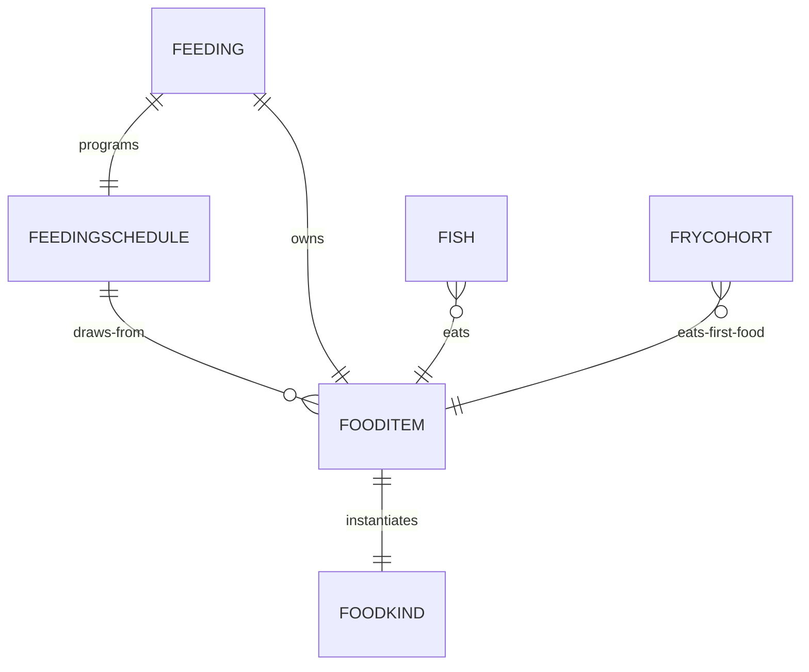

# Functional Spec — u4-feeding

> Upstream: `entities.md`, `rules.md` (BR12.1–BR13.4), `unit-of-work.md`, `unit-of-work-story-map.md` (US3.1, US3.2 → U4), `stories.md` (AC3.1.1–AC3.2.2), `requirements.md` (FR3.1, FR3.2, FR5.3), `components.md` (Feeding), `contract-summary.md` (C1–C4, amended C2 exception), U2 design (waste path), U3 design (satiety/health). Answers from `functional-design-questions.md` (Q1–Q6, summary `Looks correct`).
> Implements US3.1 and US3.2. Continues workflow numbering at W16.

## Workflows

### W16 — Buy food (US3.1; BR12.1, BR12.2)

1. U7 dispatches `feeding.buyFood { kind, qty }` (prices: flakes 2, pellets 4, liveFirst 6 $FISH per portion).
2. Reject UNKNOWN_ENTITY / INVALID_QUANTITY / INSUFFICIENT_FUNDS with no mutation.
3. Deduct, append one dated stack, emit `moneyChanged { delta: −price, balance }`; bus bumps version once.

### W17 — Manual fish feed (US3.2; BR13.1, BR13.2, AC3.2.1, AC3.2.2)

1. U7 dispatches `feeding.feedFish { foodId, portions }`.
2. Validate stack (NOT_AVAILABLE if missing/expired/dry), portions (INVALID_QUANTITY), target (INVALID_SETTING for fry food).
3. Dispense `d = min(portions, usable)`; restore `round(25 × quality)` satiety per portion in strict ascending-satiety, roster-tiebreak order, filling one fish to 100 before moving on; emit `fed { foodId, portion: eaten }`.
4. Leftover → `waste += leftover × 2.0` (clamp 100) + `overfed { wasteDelta }`; stack at 0 → remove + `foodOut { foodId }`; bus bumps version once.
5. AC3.1.1: with zero usable stock the command rejects NOT_AVAILABLE — fish go unfed, growth/breeding stall downstream, and nothing else changes.

### W18 — Auto-feeder (US3.2; BR13.4)

1. U2 sells/installs the `autoFeeder` device (U2 data completion: `Equipment.autoFeeder { installed }`, `buyEquipment` kind, `equipment.autofeeder` unlock, price 150).
2. U7 dispatches `feeding.setAutoFeeder { foodKind, portions, intervalHours }` (fish-target kinds only; NOT_AVAILABLE without the device; INVALID_QUANTITY on non-positive numbers; setting an empty program clears it). A new program sets `lastRunHour` to the creation absolute hour (`gameDay × 24 + gameHour`) — the first run fires after one full interval, never as an immediate backlog run.
3. U4's feeding-phase system runs due schedules as W17-equivalents (same events, same waste math, FIFO stacks); dry runs skip silently.

### W19 — Fry feed (US3.2 + FR5.3; BR13.3)

1. U7 dispatches `feeding.feedFry { foodId, cohortId, portions }` (fry-food kinds only).
2. Same validation/dispensing/event shape as W17 (eggs-stage cohorts rejected INVALID_SETTING — eggs don't eat), with fry eaten = min(portions, ceil(cohort.count / 10)) (10 fry per portion), applied to the cohort (result carries `waste` too): U4 updates `firstFoodDays`/`lastFryFedDay` with day idempotency — first feed of a new game day increments, same-day repeats leave the counters unchanged.
3. U5's stunt rule reads the counters; unfed cohorts stunt per U5 design — U4 neither knows nor stores the penalty.

### W20 — Expiry sweep (BR12.3)

1. Every feeding-phase tick, U4 scans stacks: each stack whose last usable day was yesterday emits `foodOut { foodId }` once, then stays listed as expired.
2. No mapper change: the existing `foodOut` → warn mapping covers expiry-driven dryness; panels additionally show expired flags via `foodStock`.

## State machines

**Stack:** `stocked (qty > 0)` → `depleted (removed, foodOut emitted)`; `fresh` → `expired` by game day (expired stays listed, never dispenses).

**Feeder:** `no device` → `device, no program` → `programmed, running` (ticks advance `lastRunHour`); clearing the program returns to idle without uninstalling.

## Command catalogue (U4 augments U1's CommandMap)

| Command | Payload | Result | Errors |
|---|---|---|---|
| `feeding.buyFood` | `{ kind, qty }` | `{ foodId, qty, price }` | UNKNOWN_ENTITY, INVALID_QUANTITY, INSUFFICIENT_FUNDS |
| `feeding.feedFish` | `{ foodId, portions }` | `{ eaten, leftover, waste }` | NOT_AVAILABLE, INVALID_QUANTITY, INVALID_SETTING |
| `feeding.feedFry` | `{ foodId, cohortId, portions }` | `{ eaten, leftover, waste }` | NOT_AVAILABLE, INVALID_QUANTITY, INVALID_SETTING, UNKNOWN_ENTITY |
| `feeding.setAutoFeeder` | `{ foodKind, portions, intervalHours } \| null` | `{ set: boolean }` | NOT_AVAILABLE, INVALID_QUANTITY, INVALID_SETTING |

## Event catalogue (U4 variants from the C4 target catalogue; no new variants)

| Event | Fields | When |
|---|---|---|
| `fed` | `{ foodId, portion }` | W17/W18/W19 dispensing (portion = eaten) |
| `overfed` | `{ wasteDelta }` | W17/W18/W19 leftovers |
| `foodOut` | `{ foodId }` | Any stack reaching 0 |

## Selectors (U4-owned)

- `foodStock(state, kind?)` — stacks for U7 panels (incl. expired flags).
- `usableFood(state, kind)` — non-expired portions, oldest-first order.
- `feedingProgram(state)` — schedule + device state for the U7 feeder panel.

## Coordination notes

- **U1**: `GameState.feeding.schedule` section; `FoodItem.acquiredDay` + `target` fields; new-save bootstrap stocks 10 flakes (BR12.4).
- **U2 (data completion, additive)**: `Equipment.autoFeeder { installed }`, `tank.buyEquipment` kind `autoFeeder` level 1, price 150, `equipment.autofeeder` unlock — same pattern as the heater; no BR change (BR9.1 covers equipment generally).
- **U3**: satiety restore amounts already assume quality scaling (`round(25 × quality)`); no U3 change (growth condition reads satiety, unchanged).
- **U5 (data, required)**: `FryCohort.firstFoodDays` + `lastFryFedDay` counters written by W19 under the C2 exception; stunt rule reads them.
- **U6**: awards `equipment.autofeeder` through progression; maps `foodOut` → warn, `overfed` → info; `moneyChanged` reuse needs no mapper change.
- **C2 amendment (third)**: the exception now reads "U4's feeding path may write `tank.water.waste` and `Fish.satiety`, and U4's feedFry path may write the cohort's `firstFoodDays`/`lastFryFedDay`".

## Rules summary

BR12.1 three fixed kinds; BR12.2 atomic buyFood with dated stacks and stated total; BR12.3 game-day expiry with sweep foodOut, oldest-first scheduled draw, named-stack commands; BR12.4 10-flake starter; BR13.1 ascending-satiety quality-scaled restore; BR13.2 leftovers to waste with overfed/foodOut; BR13.3 day-idempotent feedFry into U5 counters; BR13.4 scheduled replay (runs on catch-up, silent skips, no backlog run).
