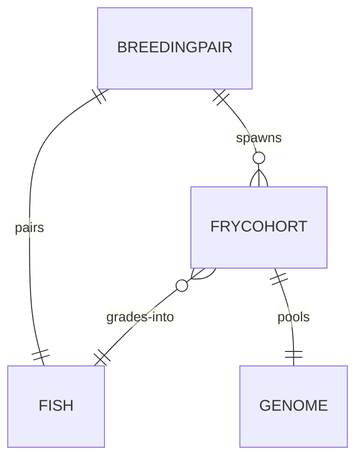

# Functional Spec — u5-breeding

> Upstream: `entities.md`, `rules.md` (BR14.1–BR15.4), `unit-of-work.md`, `unit-of-work-story-map.md` (US5.1–US5.3 → U5), `stories.md` (AC5.1.1–AC5.3.1), `requirements.md` (FR5.1–FR5.3), `components.md` (Breeding), `contract-summary.md` (C1–C4), U3 design (spawnFish/inheritGenome, Fish field rules, projectedBioload), U4 design (feedFry, counters). Answers from `functional-design-questions.md` (Q1–Q6, summary `Looks correct`).
> Implements US5.1–US5.3. Continues workflow numbering at W21. Out of MVP scope by decision: fry cannibalism/plant cover (no plants in MVP), inbreeding/mutation (Milestone 3), culling commands, egg fungus minigame.

## Workflows

### W21 — Pair and unpair (US5.1; BR14.1)

1. U7 dispatches `breeding.pair { femaleId, maleId }` (eligibility: both alive adults, sexes match slots, same species, archetype in {livebearer, scatter, plant}) or `breeding.unpair { pairId }`.
2. Reject UNKNOWN_ENTITY (missing fish/pair), INVALID_SETTING (sex/species/archetype/immaturity mismatch, or female already gravid/cooling — re-pairing never resets gestation or cooldown; unpair first).
3. New pair state `paired`, readyDay = today; bus bumps version once. No event on pairing (panel-pull state).

### W22 — Spawn attempts (US5.1; BR14.2)

1. U5's breeding-phase system (after fish, before commerce) iterates pairs.
2. Dissolve pairs with missing members first (BR15.4, silent); promote `cooling` pairs with today ≥ readyDay back to `paired`.
3. For `paired` pairs with all gates passing (mature, health ≥ 40, satiety ≥ 30, tempFit ≥ 0.5, quality ≥ 40), roll per-tick probability = baseRate × condition / 24 (speciesBaseRate ≈ 0.3/day default from catalogue).
4. On success: livebearer → gravid path (W23a); scatter/plant → egg-laying path (W23b). On gate failure: nothing — no penalty, no event.

### W23a — Gestation and birth (livebearer; BR14.3, AC5.1.1)

1. Conception sets `gravid` with readyDay = birth due date, emits `breedingStarted { fishIds }`.
2. At readyDay: fry cohort (seeded clutch draw scaled by mother × condition, clamped to catalogue range, genomePool = parents), `fryHatched`, pair to `cooling` with readyDay = today + cycleDays.

### W23b — Laying and hatching (egg-layers; BR14.4, AC5.1.2, AC5.2.1)

1. Laying creates an eggs cohort (fertility-rolled count, hatchDay), emits `breedingStarted`.
2. Eggs sit: no feeding (feedFry rejects eggs-stage cohorts), no decay, no interaction.
3. At hatchDay: stage → fry, emits `fryHatched { cohortId, count }`; the pair is unaffected (already cooling; if readyDay arrived first it may already be paired again — clutches overlap).

### W24 — Fry life (US5.2, US5.3; BR15.1)

1. Each tick: ageDays += 1/24 (accrues from laying through both stages — incubation counts toward juvenileDays, so the fry phase is juvenileDays minus hatchDays by construction); on the midnight tick apply the day-boundary decay (floor(count × dailyKeep)); newborn grace and food test per BR15.1.
2. U4's feedFry writes firstFoodDays/lastFryFedDay; U5 never touches food stock.
3. Zero-count cohorts removed silently.

### W25 — Grading (US5.2, US5.3; BR15.2, BR15.3, AC5.2.2, AC5.3.1)

1. U7 dispatches `breeding.grade { cohortId, count }` when panels show ageDays ≥ juvenileDays.
2. Reject INVALID_SETTING (eggs / not ready), INVALID_QUANTITY, TANK_FULL (batch formula: bioload + N × (adultSizeCm − 0.05) ≤ volumeL — only the leaving share converts to adult load; all-or-nothing per call).
3. Create Fish per U3 field rules (sex 50/50, parents, inheritGenome each, stunted from the BR15.2 test); emit `cohortGraded { cohortId, count }`; remainder stays; bus bumps version once.

## State machines

**Pair:** `paired` → (`gravid` → birth →) `cooling` → `paired` at readyDay; any state → dissolved on member loss.
**Cohort:** `eggs` → `fry` at hatchDay → graded away (count down) or decayed to 0.

## Command catalogue (U5 augments U1's CommandMap)

| Command | Payload | Result | Errors |
|---|---|---|---|
| `breeding.pair` | `{ femaleId, maleId }` | `{ pairId }` | UNKNOWN_ENTITY, INVALID_SETTING |
| `breeding.unpair` | `{ pairId }` | `{ removed: true }` | UNKNOWN_ENTITY |
| `breeding.grade` | `{ cohortId, count }` | `{ graded: number, stunted: number }` | UNKNOWN_ENTITY, INVALID_SETTING, INVALID_QUANTITY, TANK_FULL |

## Event catalogue (U5 variants from the C4 target catalogue; no new variants)

| Event | Fields | When |
|---|---|---|
| `breedingStarted` | `{ fishIds: [FishId, FishId] }` | W23a conception / W23b laying |
| `fryHatched` | `{ cohortId, count }` | W23a birth / W23b hatch |
| `cohortGraded` | `{ cohortId, count }` | W25 grading (graded count; remainder stays) |

## Selectors (U5-owned)

- `pairsInTank(state)`, `cohortsInTank(state)`, `breedingReadiness(state, pairId)` — condition breakdown for the U7 breeding screen.
- `gradePreview(state, cohortId, count)` — projected capacity (same batch formula: bioload + N × (adultSizeCm − 0.05)) + stunting outcome without mutating (U7 confirm screen).

## Coordination notes

- **U1 (data completion, additive)**: per breeding species — `clutch: [min, max]`, `gestationDays`, `hatchDays`, `cycleDays`, `speciesBaseRate` (≈0.3 default), breeding `tempC` range (reuse tempRangeC); only the three MVP archetypes breed (others reject at pairing with INVALID_SETTING — archetype check in BR14.1's eligibility). Plus `GameState.pairs: Record<PairId, BreedingPair>` with save/load round-trip (pre-U5 saves load pairs = {}); lands with U5's implementation.
- **U3 (data completion, additive)**: `Fish.stunted: boolean` (false default; spawnFish sets false) + growth-formula factor × (stunted ? 0.8 : 1) in BR10.1/W12; graded Fish otherwise follow BR11.1 field rules with parents set.
- **U4**: feedFry eaten rule pinned here — eaten = min(portions, ceil(cohort.count / 10)) per feed (10 fry per portion); amendment to U4 BR13.3/W19. Remainder is leftover → waste as usual.
- **U2**: graded batches call `projectedBioload` with adultSizeCm (conservative — juveniles count full; documented over-estimate, never an under-estimate).
- **U6**: maps `breedingStarted`/`fryHatched`/`cohortGraded` → info; price formula reads genomeQuality (unaffected by stunting — size factor carries it).

## Rules summary

BR14.1 player pairing with validation (no re-pair reset); BR14.2 condition-scaled attempts with bound gates and no punishment; BR14.3 livebearer gestation and seeded scaled broods; BR14.4 fertile-rolled eggs with timed hatch; BR14.5 cycleDays cooldown; BR15.1 day-boundary fry survival with newborn grace; BR15.2 permanent stunt from the food test; BR15.3 capacity-guarded batch player grading; BR15.4 silent cleanup.
