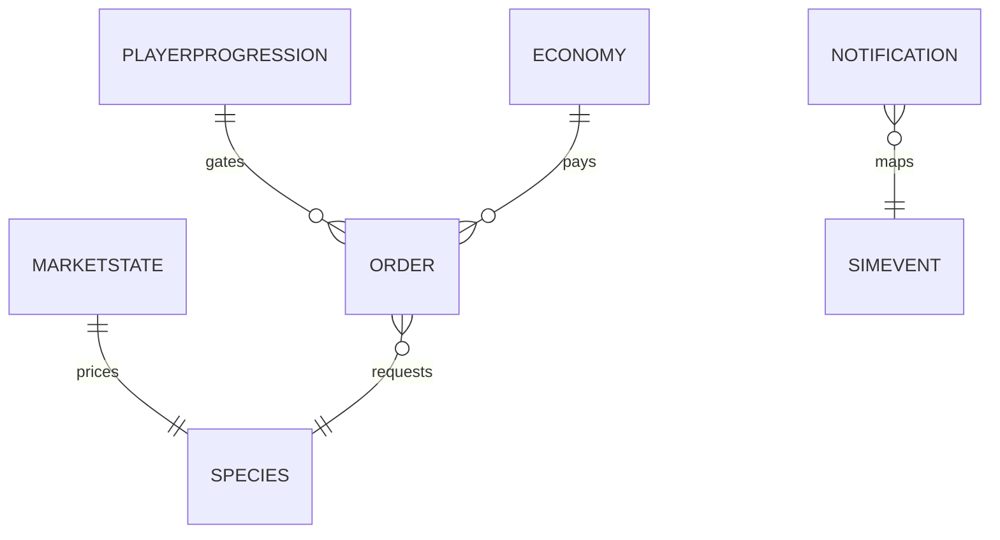

# Functional Spec — u6-commerce

> Upstream: `entities.md`, `rules.md` (BR16.1–BR19.3), `unit-of-work.md`, `unit-of-work-story-map.md` (US6.1–US8.1, US12.1 → U6; money side of US1.3/US2.1), `stories.md` (AC6.1.1–AC12.1.1), `requirements.md` (FR6.1–FR8.1, FR12.1), `components.md` (Market, Orders, Progression, Economy, Notifications), `contract-summary.md` (C1–C4), U2 design (projectedBioload, tankOvercrowded/fishSick aggregation need, unlock ids), U3 design (spawnFish, trio annotation, selectors), U5 design (fryHatched XP source). Answers from `functional-design-questions.md` (Q1–Q6, summary `Looks correct`).
> Implements US6.1–US6.3, US7.1, US8.1, US12.1 plus the money side of US1.3/US2.1. Continues workflow numbering at W26. Out of MVP scope by decision: market shock events (activeEvent reserved), debt/shutoff on shortfall, order cancellation commands, lifetime stats aggregates.

## Workflows

### W26 — Buy fish (US2.1 money side; BR16.5, BR18.2, U2 projectedBioload; AC2.1.1, AC2.1.2, AC1.3.1, AC1.3.2 money side)

1. U7 dispatches U6's `commerce.buyFish { speciesId }`.
2. Reject UNKNOWN_ENTITY (unknown/unlisted species), NOT_AVAILABLE (tier > level, or scatter/plant at L1), TANK_FULL (U2 `projectedBioload(state, adultSizeCm)` breach — never head-count), INSUFFICIENT_FUNDS.
3. Build the juvenile via U3's pure `spawnFish(state, species, rng)`, deduct `buyPrice`, emit the trio `fishBought` + `fishSpawned` + `moneyChanged` (U6 is the authorised emitter of U3's `fishSpawned` on this path; the mapper collapses the pair into one info notification). Version bumps once.

### W27 — Price a fish (US6.2; BR16.1, AC6.2.1)

1. Any price read runs BR16.1 over live demand/trend: `sellPrice(state, fishId)` selector (U6-owned, pure).
2. Factor inputs owned elsewhere are read through their selectors: hue-locus colour and premium-allele rarity and `genomeQuality` via U3, `demand`/`trend` from `state.market`. Stunting needs no factor — it already shrank `sizeCm`.
3. The commerce-phase system refreshes the `Fish.value` cache from the same formula every tick (the allowlisted C2 cross-entity write); the cache is display-only and never an input to a later price.

### W28 — Sell single and bulk (US6.1, US6.3; BR16.2, BR16.3, AC6.1.1, AC6.1.2, AC6.3.1)

1. U7 dispatches `commerce.sellFish { fishId }` or `commerce.sellBulk { fishIds }` (empty list rejects INVALID_QUANTITY).
2. Single: missing fish rejects UNKNOWN_ENTITY, sick (health < 40) rejects FISH_UNSELLABLE, nothing changes. Bulk: deduplicate ids to a set, then unknown ids reject UNKNOWN_ENTITY; sick entries are skipped and the eligible remainder proceeds; an empty eligible remainder rejects FISH_UNSELLABLE.
3. Remove each sold fish, pay Σ fulfil-time formula prices, apply demand ×0.97 per fish sequentially, emit one `fishSold` per fish + one `moneyChanged` with the total, add Σ floor(price/5) XP (level checks in W33). All-or-nothing per call.

### W29 — Demand recovery and trend cycle (US6.3; BR16.4, AC6.3.1)

1. At each day boundary: `demand += (1 − demand) × 0.08` for every species.
2. When `today − lastTrendDay ≥ 3`: re-roll `trend` via `ctx.rng` weighted to 0 (P(−1) = 0.25, P(0) = 0.5, P(1) = 0.25), set `lastTrendDay = today`. `activeEvent` stays null.

### W30 — Board upkeep (US7.1; BR17.1)

1. At each day boundary after expiry (W32): top up to 3 open orders; while below 6, one 25% `ctx.rng` roll for an extra.
2. Each generated order: species uniform over buyable species (tier ≤ level), customer from the level pool, qty/health/multiplier per the BR17.1 customer table, `minSizeCm` = species market size, `deadlineDay` = today + 3 + floor(rng × 5), `reward` = board estimate floor(quantity × sellBase × multiplier).

### W31 — Fulfil an order (US7.1; BR17.2, AC7.1.1)

1. U7 dispatches `orders.fulfil { orderId, fishIds }` from the order board (U7 pre-fills candidates meeting species/count; duplicate ids are harmless — the handler deduplicates before counting; the handler re-validates everything).
2. Reject in precedence UNKNOWN_ENTITY (order/fish unknown) > FISH_UNSELLABLE (any health < 40) > INVALID_SETTING (closed order, deduplicated count ≠ quantity, species/health/size mismatch) — the whole call rejects, nothing changes.
3. Remove the fish, compute the fulfil-time reward (Σ formula prices × multiplier × rep bonus, floored), pay it, set `status = fulfilled` with `reward` overwritten to the actual, emit `orderFulfilled` + `moneyChanged` (no `fishSold`, no saturation), reputation +1, XP += floor(reward/4).

### W32 — Order expiry (US7.1; BR17.3, AC7.1.2)

1. At each day boundary before upkeep: every open order with `today > deadlineDay` becomes `expired`, reputation = max(0, reputation − 2), emits `orderExpired`.
2. Expired and fulfilled orders leave the board at the same boundary, freeing slots for W30.

### W33 — XP and level-ups (US8.1; BR18.1, BR18.2, AC8.1.1, AC8.1.2)

1. XP accrues from sales (W28), U5 `fryHatched` sightings (+10 per event, counted in the commerce phase so catch-up batches count identically), and fulfils (W31); thresholds are checked wherever XP is added, so sale/fulfil handlers grant-then-check atomically.
2. Thresholds L2 200 / L3 600 are the initial calibration for the ~2 h target (AC8.1.2 is validated in playtest, not in unit test — the numbers are data-like constants the balance pass may tune without a rule change); levels cascade in one tick with one levelUp per level gained, ascending.
3. On crossing: set level, append the level's unlock ids, emit levelUp. Species gating (tier ≤ level, egg-layers L2+) applies from the next command — same-day unlocks feed the next board upkeep because level checks run before upkeep in the boundary order.

### W34 — Midnight operating costs (BR19.1)

1. At each day boundary with recovery/expiry/upkeep: deduct tier electricity (5/12/25) via `money = max(0, money − cost)`. No event, no debt, no shutoff.

### W35 — Notifications (US12.1; BR19.2, BR19.3, AC12.1.1)

1. U6 registers the single notification mapper plus a notify-phase system. The mapper applies the BR19.2 table; fishSick always maps to null (single owner: the notify system).
2. The notify system owns all fishSick notifications: it scans the tick's buffered events pre-drain and appends exactly one warn per tick with sick events directly to state.notifications — a singleton naming the fish (`subjectId = fishId`, click-to-focus per AC12.1.1) or a `fishSickBatch` summary carrying the count. It also emits the single `whileYouWereAway` summary after catch-up.
3. Queue cap 100 (drop oldest info, then warn, never critical). U7 dispatches `notifications.dismiss { notificationId }` to remove one entry.

## Day-boundary order (all in the commerce phase unless noted)

Recovery (W29) → costs (W34) → expiry (W32) → hatch XP + level checks (W33) → upkeep (W30) → value-cache refresh → (notify phase) fishSick aggregation + away summary (W35). Level checks run before upkeep so same-day unlocks feed the board — no gating lag. One version bump per tick.

## State machines

**Order:** `open` → `fulfilled` (W31) | `expired` (W32) → removed same boundary. No reopen.
**MarketState:** `demand` saw-tooths around sales and recovery; `trend` steps every 3 days; `activeEvent` pinned null.

## Command catalogue (U6 augments U1's CommandMap)

| Command | Payload | Result | Errors |
|---|---|---|---|
| `commerce.buyFish` | `{ speciesId }` | `{ fishId, price }` | UNKNOWN_ENTITY, NOT_AVAILABLE, TANK_FULL, INSUFFICIENT_FUNDS |
| `commerce.sellFish` | `{ fishId }` | `{ price }` | UNKNOWN_ENTITY, FISH_UNSELLABLE |
| `commerce.sellBulk` | `{ fishIds }` | `{ sold: number, skipped: number, total: number }` | INVALID_QUANTITY, UNKNOWN_ENTITY, FISH_UNSELLABLE (empty eligible remainder) |
| `orders.fulfil` | `{ orderId, fishIds }` | `{ reward, reputation }` | UNKNOWN_ENTITY, INVALID_SETTING, FISH_UNSELLABLE |
| `notifications.dismiss` | `{ notificationId }` | `{ removed: true }` | UNKNOWN_ENTITY |

Money-side note: U2's `tank.upgradeTier` and `tank.changeWater` (volume fee) deduct through the shared money scalar U6 owns (atomic inside U2's handlers per its design — the AC1.3.1/AC1.3.2 money side); U4's food purchases deduct the same way. All three are allowlisted purchase-path exceptions in C2 (validate-first, deduct-or-reject atomic, one `moneyChanged` per accepted call on the U6 shape — see contract amendment); U6 does not expose a separate `spend` command. AC2.1.2 browse lists all 30 species with buyability from `buyableSpecies(state)` (locked entries shown, not hidden).

## Event catalogue (U6 variants from the C4 target catalogue; no new variants)

| Event | Fields | When |
|---|---|---|
| `fishBought` | `{ fishId, speciesId, price }` | W26 (with `fishSpawned` + `moneyChanged` trio) |
| `fishSold` | `{ fishId, price }` | W28 per fish (not on fulfil) |
| `orderFulfilled` | `{ orderId, reward }` | W31 |
| `orderExpired` | `{ orderId }` | W32 |
| `levelUp` | `{ level }` | W33 |
| `moneyChanged` | `{ delta, balance }` | W26 / W28 / W31 (totals per call) |

`fishSick` cause extends to `'waterQuality' \| 'temperature'` (U2 additive; mapper treats both as warn). `tankOvercrowded` (`{ bioload, capacity }`) is U2's additive variant, mapped warn.

## Selectors (U6-owned)

- `sellPrice(state, fishId)`, `bulkPreview(state, fishIds)` — price without mutating (U7 confirm screens; bulk preview flags skipped sick/missing).
- `orderRewardPreview(state, orderId, fishIds)` — fulfil-time reward without mutating.
- `buyableSpecies(state)`, `levelProgress(state)` — store gating and HUD (`xpToNext` derived, never stored).
- `notificationQueue(state)` — capped visible queue for U7.

## Coordination notes

- **U1 (data completion, additive)**: per-species `sellBase`, `buyPrice`, `tier`, `archetype`, `adultSizeCm`, market size; catalogue `sellBase` defaults to `buyPrice` when absent (content rule, validated at build).
- **U2**: every stocking check calls `projectedBioload` (never head-count); U6 maps `tankOvercrowded` → warn and aggregates its `fishSick` bursts (U2 R-07 input closed here); equipment/tier unlock ids flow through BR18.2.
- **U3**: `spawnFish` factory for W26; `genomeQuality`, colour-locus, rarity-allele selectors for BR16.1; sick threshold health < 40 shared; `Fish.value` cache refresh is the ratified C2 exception.
- **U4**: `foodOut` → warn (no mapper change); food purchases deduct through the money scalar inside U4's handler under the C2 purchase-path exception (same atomicity as BR16.5).
- **U5**: `fryHatched` → info + 10 XP (commerce phase sighting); `breedingStarted`/`cohortGraded` → info; stunting needs no price factor (size carries it).
- **U7**: sell/fulfil confirm screens call the preview selectors; notification clicks focus `subjectId`; the composition root imports U6's `index.ts` so the mapper registration loads.

## Rules summary

BR16.1 eight-factor price with stated bands; BR16.2 sick unsellable (bulk skips, fulfil rejects, dedupe, precedence); BR16.3 atomic sell with saturation and XP; BR16.4 daily recovery and 3-day trends; BR16.5 atomic buy with shared purchase atomicity; BR17.1 board upkeep 3–6; BR17.2 fulfil-time premium without saturation; BR17.3 expiry with rep −2; BR18.1 three-source XP with cascade 200/600; BR18.2 tier/egg-layer gates with accumulating unlocks; BR19.1 midnight electricity clamped at 0; BR19.2 notify-owned fishSick aggregation; BR19.3 bounded dismissable queue (criticals may overflow).
