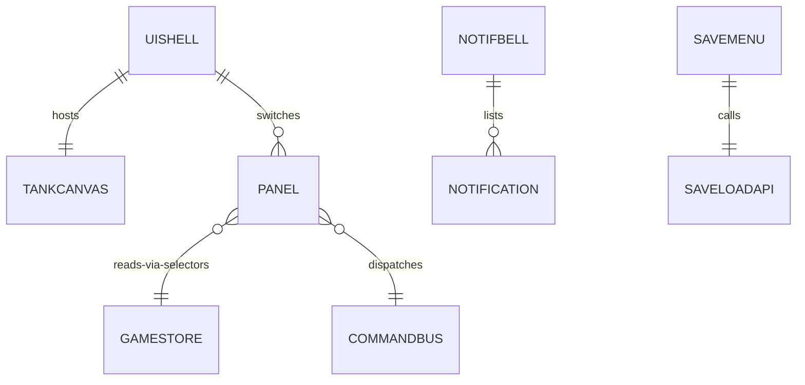

# Functional Spec — u7-presentation

> Upstream: `entities.md` (none — `ui`-kind unit carries no entities/rules; this file is self-contained), `unit-of-work.md`, `unit-of-work-story-map.md` (US1.1 → U7; US11.1 shared U1/U3/U7), `stories.md` (AC1.1.1, AC1.1.2, AC11.1.1), `requirements.md` (FR1.1, FR9.1–FR9.3, FR10.1, FR12.1, NFR2), `components.md` (TankRenderer, UI), `contract-summary.md` (C1 read-only store + selectors, C2 register order, C5 boot validation, C6 save/load API). Answers from `functional-design-questions.md` (Q1–Q6 all A).
> Implements US1.1 fully and the U7 share of US11.1; renders every other unit's state and dispatches their commands without mutating the store. Continues workflow numbering at W36 (W36–W49). Reference: GDD §6.1 (time/day-night), §7 (interface/UX), §9 (technical/save design). Out of MVP scope by decision: audio design beyond event subscription hooks, PWA install/update UX (shell-only manifest), multi-save-slot limit UI (API allows N; screen shows what the API lists).

## Read-only discipline

U7 never writes `GameState`. Screens read via selectors and re-render when `version` bumps; player intent travels only through `dispatch(type, payload)`; command outcomes drive the UI (`ok` → refresh from store, `err` → show `error.message` mapped to the originating screen). Render state (sprite positions, steering velocities, particles) lives outside the store and is never serialized.

## Workflows

### W36 — Living tank render loop (US1.1; AC1.1.1, AC1.1.2)

1. On new save, the Tank canvas mounts: one procedural sprite per fish (palette/pattern/fin catalogue tokens), substrate, plants, ambient bubble/particle layers.
2. Every frame, boids-style steering updates swim positions render-side only; lighting tint follows `gameDay`/`gameHour` continuously.
3. Idle leaves the loop running — fish keep swimming, plants sway, bubbles rise (AC1.1.2). A new save opens directly on this animated scene (AC1.1.1).

### W37 — Day/night and reduced motion (NFR2)

1. Lighting tint/overlay track the game clock with smooth transitions.
2. With `settings.reducedMotion` on: ambient layers freeze (no sway/bubbles/particles), lighting snaps without transitions, fish keep swimming at minimal amplitude with no darting — the tank stays alive but calm.

### W38 — HUD, toolbar, time controls (FR10.1)

1. Top bar shows money ($FISH), level + XP bar (`xpToNext` derived), game-day clock, pause/x1/x2/x4 controls, and the notification bell with unread count.
2. Speed buttons dispatch `clock.setSpeed { speed: 1 | 2 | 4 }`; Pause dispatches `clock.setPaused { paused: true }`; Resume dispatches `clock.setPaused { paused: false }` (unpause restores speed 1 per U1 BR1.2 — no prior-speed restore). Settings edits (reducedMotion, autoPauseCritical, volume) dispatch `settings.update` with the changed fields only.
3. Toolbar tabs: Tank, Store, Feeding, Breeding, Orders, Roster, Save, Settings (Feeding and Settings added by review repair — the Q3 6-tab set left the core loop unwirable; see W48/W49). Fish panel (click a fish): health with named cause, satiety, size/stage, value preview, sell button. Roster: management table with bulk-select + bulk-sell. Tab state is local UI state, never in `GameState`.
4. The HUD shows a loading indicator whenever queued live ticks exceed one frame's worth (C2 accumulate policy); sustained backlog and catch-up run behind the loading state, never as a frozen frame.

### W39 — Fish panel and roster (U3/U6 commands)

1. Clicking a fish opens its panel: health with named cause, satiety, size/stage, `sellPrice` preview, Sell button dispatching `commerce.sellFish`; rejected outcomes show the named error in place.
2. Roster lists all fish with bulk-select; Bulk Sell dispatches `commerce.sellBulk` and reports `{ sold, skipped, total }`, flagging skipped sick fish by name.

### W40 — Store screen (U6/U2 commands)

1. Lists all 30 species from `buyableSpecies(state)` — locked entries shown with their unlock requirement, never hidden (AC2.1.2 rendering).
2. Buy dispatches `commerce.buyFish`; equipment/tier purchases dispatch U2's upgrade commands. INSUFFICIENT_FUNDS / NOT_AVAILABLE / TANK_FULL surface the handler message at the tapped item.

### W41 — Breeding screen (U5 commands)

1. Shows pairs with condition breakdown (`breedingReadiness`), cohorts with age bars and `gradePreview` stunting/capacity outcome.
2. Pair/unpair/grade dispatch `breeding.pair` / `breeding.unpair` / `breeding.grade`; INVALID_SETTING (eggs, not ready, gravid/cooling re-pair) explains itself in the panel.

### W42 — Orders board (U6 commands)

1. Renders open orders with species, quantity, min health/size, reward estimate, deadline countdown; Fulfil dispatches `orders.fulfil` with the chosen fish; expiry/fault messages render from outcomes.
2. Reward shown pre-fulfil is the board estimate; post-fulfil the actual overwrites it (per U6 W31).

### W43 — Notification bell (U6 queue rendering; FR12.1)

Ownership note: US12.1 is mapped to U6 only, and AC12.1.1 stays with U6's queue design — U7 renders the U6-owned `notificationQueue` and owns no notification behaviour.

1. Bell lists `notificationQueue(state)` newest-first with priority icon + text (never colour alone); clicking a fish notification focuses that fish in the tank; order/deadline entries jump to the Orders tab.
2. Dismiss dispatches `notifications.dismiss`; aria-live polite, criticals assertive; `autoPauseCritical` pauses the clock on criticals when set.

### W44 — Save/load menu (FR9.1–FR9.3; C6)

Persistence is deliberately not a command (C6: the save must work while the clock is paused and is not a simulation action). The menu calls the SaveLoadApi directly and never dispatches through the command bus.

1. Shows autosave slots + named manual slots via `listSlots()`; Save calls `saveToSlot(name)`, Load calls `load(ref)` — a STALE_SAVE outcome opens a confirm-then-retry dialog, never silent overwrite; Delete calls `deleteSlot(ref)`.
2. Export downloads `exportFile()` JSON; Import calls `importFile(text)` alongside the current save — CORRUPT_JSON / INVALID_SHAPE / UNSUPPORTED_VERSION / CHECKSUM_MISMATCH / MIGRATION_FAILED surface the named error with the current save untouched.

### W45 — While-you-were-away summary (US11.1 U7 share; AC11.1.1)

1. After catch-up, one modal shows elapsed days plus the hatched/matured/died-of-old-age/orders-expired counts computed from the catch-up event batch (U1 `whileYouWereAway` + U6 notify summary), with a Resume button; the tank behind it shows fish in protected critical state. Resume dispatches `clock.setPaused { paused: false }`, so the clock restarts at speed 1 per U1 BR1.2.

### W46 — Fault panel (C2 tick-abort rule)

1. A throwing system surfaces the full-screen fault panel with the error and a "reload to last autosave" action. U7 never attempts store rollback (C2: the last successful autosave is the recovery point).

### W47 — Composition root and boot (C2, C5, C6)

1. `main.ts` constructs the store from U1's factory, calls each sim unit's `register(registry)` — call order imposes no sim order (U1 sorts by phase) — subscribes UI/audio to the event bus, mounts the Svelte shell.
2. Boot validates the species catalogue per C5: invalid entries excluded + console-logged, never a crash. IndexedDB → localStorage fallback warns once in the UI; dev boot failures fail loudly, production shows the fault panel.

### W48 — Feeding panel (U4 commands; FR3.1, FR3.2)

1. The Feeding tab shows `foodStock(state)` stacks with quality/expiry flags, a buy row dispatching `feeding.buyFood { kind, qty }`, a manual-feed row dispatching `feeding.feedFish { foodId, portions }`, a fry-feed row dispatching `feeding.feedFry { foodId, cohortId, portions }`, and the auto-feeder program from `feedingProgram(state)` with a scheduler dispatching `feeding.setAutoFeeder { foodKind, portions, intervalHours }` (null clears it).
2. NOT_AVAILABLE without the device, INSUFFICIENT_FUNDS, and INVALID_QUANTITY surface at the row that caused them; fry cohorts are chosen from U5's `cohortsInTank` (eggs rejected by the handler, not the panel).

### W49 — Tank tab ops and Settings panel (U2/U1 commands; FR1.2, FR1.3, NFR2)

1. The Tank tab hosts Care sections reading `tankWater(state)`, `waterQuality(state)`, and `bioloadOf(state)`: a water-change row dispatching `tank.waterChange { portionPct }` (10–50, fee shown pre-dispatch), and an equipment section dispatching `tank.buyEquipment { kind, level }` / `tank.upgradeTier { tier }` with unlock-gated entries (locked entries show their requirement, enforced by the handler).
2. The Settings tab dispatches `settings.update` for `reducedMotion` (W37), `autoPauseCritical` (W43), and `volume { master, sfx }`; changes apply live and persist via the next autosave.

## Screen/state transitions

**Tabs:** stateless navigation — switching tabs never mutates the store, and each tab preserves its own panel state (selection, scroll, draft inputs) while hidden. **Modals:** away-summary and fault are blocking; STALE_SAVE confirm is blocking; all others are non-modal panels. **Focus flow:** notification click → Tank tab + camera focus on `subjectId` → fish panel opens.

## Rules summary (derived — ui unit, no rules.md)

BR20 group reserved for presentation constraints, expressed as spec obligations: W36 sprite-per-fish render-only loop; W37 reduced-motion freeze with calm swimming; W38 HUD/toolbar/time controls with exact clock commands; W43 icon+text bell with focus jumps (U6-owned queue); W44 direct SaveLoadApi surfacing; W45 single away modal with setPaused resume; W46 fault panel without rollback; W47 ordered boot with C5/C6 behaviour; W48 feeding panel with real U4 commands; W49 Tank-tab care sections and Settings panel.
