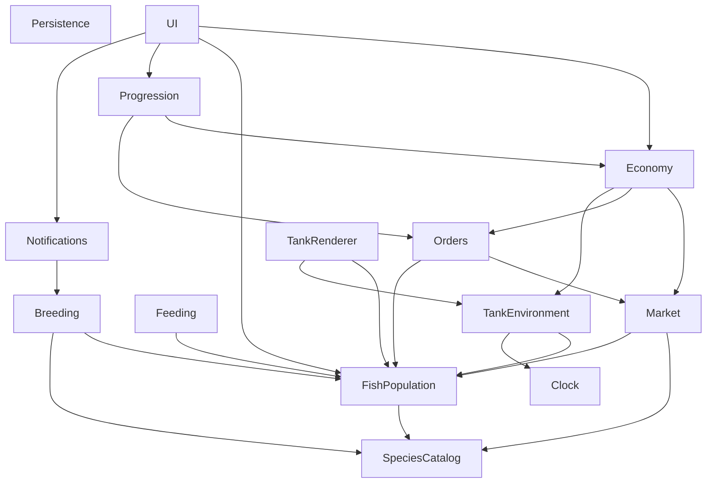

# Component Catalogue

> Upstream: `requirements.md` (FR1–FR12), `stories.md` (US1–US12), `team-practices.md` (TDD, feature branches). Logical building blocks of the simulation; rendering and UI are included as components per the confirmed Q3 answer.

## Part A — Machine-readable catalogue

```yaml
components:
  - name: Clock
    summary: Advances the fixed 1-game-hour simulation tick and the day/night cycle.
    behaviour: >
      Accumulates real time into discrete game-hour ticks at pause/x1/x2/x4; fires the
      day roll-up flag; drives offline catch-up (up to 8 game-days, coarse resolution).
    responsibilities:
      - owns the game clock (day, hour, speed, paused)
      - owns the fixed-tick advance and speed controls
    depends_on: []
    dependents: []
    entities:
      - name: GameClock
        identifier: dayHour
        attributes: [gameDay, gameHour, speed, paused]

  - name: SpeciesCatalog
    summary: Data-driven catalogue of the 30 fish species and their archetypes.
    behaviour: >
      Holds per-species data (price, size, lifespan, maturity, diet, breeding archetype,
      care difficulty, genes, palette). Read-only content loaded from data files.
    responsibilities:
      - owns the species data and archetype definitions
    depends_on: []
    dependents:
      - component: FishPopulation
        interaction: fish reference their species
      - component: Breeding
        interaction: breeding follows the species archetype
      - component: Market
        interaction: demand is tracked per species
      - component: Orders
        interaction: orders name a species
    entities:
      - name: Species
        identifier: id
        attributes: [name, archetype, tier, care, buyPrice, sellBase, genes]

  - name: FishPopulation
    summary: Owns individual fish — growth, health, death, genetics.
    behaviour: >
      Applies the growth curve, the health stressor model (hunger, water, temperature/pH,
      crowding), and death. Each fish is an individual with a unique id and genome.
    responsibilities:
      - owns the Fish entity and its lifecycle (juvenile, adult, senior, death)
    depends_on:
      - component: SpeciesCatalog
        interaction: fish reference their species
        style: sync
      - component: TankEnvironment
        interaction: water parameters drive health
        style: sync
    dependents:
      - component: Breeding
        interaction: breeding pairs fish
      - component: Feeding
        interaction: feeding raises satiety
      - component: Market
        interaction: selling reads fish value
      - component: TankRenderer
        interaction: renders fish
    entities:
      - name: Fish
        identifier: id
        attributes: [speciesId, sex, genome, stage, ageDays, sizeCm, health, satiety, stress, value]
        references:
          - entity: Species
            owned_by: SpeciesCatalog
            relationship: each fish is one species

  - name: TankEnvironment
    summary: Owns the tank and the simplified nitrogen cycle.
    behaviour: >
      Models bioload, waste, filter conversion, water changes, temperature, and equipment.
      A new filter must "cycle" before it is effective; water changes reduce waste.
    responsibilities:
      - owns the Tank entity (water, equipment, bioload)
    depends_on:
      - component: FishPopulation
        interaction: fish mass and feeding drive bioload
        style: sync
      - component: Clock
        interaction: water changes over time
        style: sync
    dependents:
      - component: FishPopulation
        interaction: water parameters drive health
      - component: TankRenderer
        interaction: renders the tank
    entities:
      - name: Tank
        identifier: id
        attributes: [tier, volumeL, water, equipment, bioload, biofilterMaturity]
        references:
          - entity: Fish
            owned_by: FishPopulation
            relationship: a tank holds many fish

  - name: Feeding
    summary: Owns food inventory and feeding (manual and auto-feeder).
    behaviour: >
      Tracks food stock, quality, and shelf life; applies feeding to fish satiety; overfeeding
      becomes waste. Auto-feeder dispenses on a fixed schedule.
    responsibilities:
      - owns the FoodItem inventory and feeding mechanics
    depends_on:
      - component: FishPopulation
        interaction: feeding raises fish satiety
        style: sync
    dependents: []
    entities:
      - name: FoodItem
        identifier: id
        attributes: [qty, quality, shelfLifeDays]

  - name: Breeding
    summary: Owns breeding across the three core archetypes.
    behaviour: >
      Applies the archetype rules (livebearer gestation, scatter/plant egg-laying); creates
      fry cohorts; applies first-food and survival factors.
    responsibilities:
      - owns breeding logic and the FryCohort entity
    depends_on:
      - component: FishPopulation
        interaction: breeds mature fish pairs
        style: sync
      - component: SpeciesCatalog
        interaction: archetype rules come from the species
        style: sync
    dependents:
      - component: Notifications
        interaction: breeding/hatching events notify the player
    entities:
      - name: FryCohort
        identifier: id
        attributes: [speciesId, count, ageDays, genomePool, survivalFactor]
        references:
          - entity: Species
            owned_by: SpeciesCatalog
            relationship: a cohort is one species
          - entity: Fish
            owned_by: FishPopulation
            relationship: a cohort has parent fish

  - name: Market
    summary: Owns demand saturation, drift, and the sale price formula.
    behaviour: >
      Applies per-species demand saturation on each sale and slow recovery over game days;
      computes sale price from size, age, colour, rarity, health, genetics, and market.
    responsibilities:
      - owns market demand and the price formula
    depends_on:
      - component: SpeciesCatalog
        interaction: demand is tracked per species
        style: sync
      - component: FishPopulation
        interaction: selling reads fish value
        style: sync
    dependents:
      - component: Orders
        interaction: order rewards are above market
      - component: Economy
        interaction: sales produce revenue
    entities:
      - name: MarketState
        identifier: speciesId
        attributes: [demand, trend, activeEvent]

  - name: Orders
    summary: Owns the order board, deadlines, and reputation.
    behaviour: >
      Holds 3–6 active orders with a deadline and minimum quality; fulfilment pays a premium
      above market; expiry costs reputation.
    responsibilities:
      - owns the Order entity and reputation
    depends_on:
      - component: Market
        interaction: order reward is above market price
        style: sync
      - component: FishPopulation
        interaction: fulfilment consumes fish
        style: sync
    dependents:
      - component: Economy
        interaction: order fulfilment produces revenue
      - component: Progression
        interaction: completed orders grant XP
    entities:
      - name: Order
        identifier: id
        attributes: [speciesId, quantity, deadline, minQuality, reward]
        references:
          - entity: Species
            owned_by: SpeciesCatalog
            relationship: an order names a species

  - name: Progression
    summary: Owns XP, levels 1–3, and unlocks.
    behaviour: >
      Grants XP from sales, breeding, and orders; levels unlock species, equipment, and
      customers. Level 3 is the MVP target.
    responsibilities:
      - owns the player level, XP, and unlock state
    depends_on:
      - component: Economy
        interaction: XP scales with sales value
        style: sync
      - component: Orders
        interaction: completed orders grant XP
        style: sync
    dependents:
      - component: UI
        interaction: shows level and unlocks
    entities:
      - name: PlayerProgression
        identifier: level
        attributes: [level, xp, unlocks]

  - name: Economy
    summary: Owns money and daily operating costs.
    behaviour: >
      Holds the player's money ($FISH) and applies revenue (sales, orders) and costs
      (operating costs per tank tier). Enforces non-negative money.
    responsibilities:
      - owns the money scalar and operating costs
    depends_on:
      - component: Market
        interaction: sales produce revenue
        style: sync
      - component: Orders
        interaction: order fulfilment produces revenue
        style: sync
      - component: TankEnvironment
        interaction: operating costs scale with tank tier
        style: sync
    dependents:
      - component: Progression
        interaction: XP scales with sales value
      - component: UI
        interaction: shows money
    entities: []

  - name: Persistence
    summary: Owns save/load, schema, migrations, autosave, and JSON export/import.
    behaviour: >
      Serializes the game state to a versioned schema; autosaves ~30s and on key events;
      supports manual slots and JSON export/import with corruption rejection.
    responsibilities:
      - owns the save schema, migrations, and autosave
    depends_on: []
    dependents: []
    entities: []

  - name: Notifications
    summary: Owns the prioritized notification queue.
    behaviour: >
      Converts sim events into prioritized notifications (hunger, illness, breeding, hatching,
      maturity, deadlines); supports click-to-focus and optional auto-pause.
    responsibilities:
      - owns the Notification entity and the queue
    depends_on:
      - component: Breeding
        interaction: breeding/hatching events notify
        style: event
    dependents:
      - component: UI
        interaction: renders the notification bell
    entities:
      - name: Notification
        identifier: id
        attributes: [priority, kind, subjectId, message]

  - name: TankRenderer
    summary: Renders the tank diorama (procedural sprites, steering, particles).
    behaviour: >
      Reads fish and tank state read-only and renders the living tank; boids steering and
      procedural sprites are render-only and never affect the simulation.
    responsibilities:
      - owns rendering state (positions, textures, particles)
    depends_on:
      - component: FishPopulation
        interaction: renders fish
        style: sync
      - component: TankEnvironment
        interaction: renders the tank
        style: sync
    dependents: []
    entities: []

  - name: UI
    summary: Owns the HUD, toolbar, panels, and screens.
    behaviour: >
      Reads state read-only and emits commands; presents the HUD, toolbar tabs, fish info,
      breeding screen, save/load menu, and notifications. Never mutates state directly.
    responsibilities:
      - owns the user interface shell and screen composition
    depends_on:
      - component: Economy
        interaction: shows money
        style: sync
      - component: FishPopulation
        interaction: shows fish panels and roster
        style: sync
      - component: Progression
        interaction: shows level and unlocks
        style: sync
      - component: Notifications
        interaction: renders the notification bell
        style: sync
    dependents: []
    entities: []
```

## Part B — Human-readable view

### Component Diagram



### Component Summary

| Component | Purpose | Depends On | Dependents | Entities Owned |
|---|---|---|---|---|
| Clock | game time + tick | — | Tank | GameClock |
| SpeciesCatalog | 30-species data | — | Fish, Breeding, Market, Orders | Species |
| FishPopulation | individual fish | SpeciesCatalog, TankEnvironment | Breeding, Feeding, Market, TankRenderer | Fish |
| TankEnvironment | tank + nitrogen cycle | FishPopulation, Clock | FishPopulation, TankRenderer | Tank |
| Feeding | food + feeding | FishPopulation | — | FoodItem |
| Breeding | breeding + cohorts | FishPopulation, SpeciesCatalog | Notifications | FryCohort |
| Market | demand + price | SpeciesCatalog, FishPopulation | Orders, Economy | MarketState |
| Orders | order board + reputation | Market, FishPopulation | Economy, Progression | Order |
| Progression | levels + unlocks | Economy, Orders | UI | PlayerProgression |
| Economy | money + costs | Market, Orders, TankEnvironment | Progression, UI | — |
| Persistence | save/load | — | — | — |
| Notifications | notification queue | Breeding | UI | Notification |
| TankRenderer | render the tank | FishPopulation, TankEnvironment | — | — |
| UI | HUD + screens | Economy, FishPopulation, Progression, Notifications | — | — |

### Entity Ownership

| Entity | Owning Component | Identifier | Attributes | References |
|---|---|---|---|---|
| GameClock | Clock | dayHour | gameDay, gameHour, speed, paused | — |
| Species | SpeciesCatalog | id | name, archetype, tier, care, buyPrice, sellBase, genes | — |
| Fish | FishPopulation | id | speciesId, sex, genome, stage, ageDays, sizeCm, health, satiety, stress, value | Species |
| Tank | TankEnvironment | id | tier, volumeL, water, equipment, bioload, biofilterMaturity | Fish |
| FoodItem | Feeding | id | qty, quality, shelfLifeDays | — |
| FryCohort | Breeding | id | speciesId, count, ageDays, genomePool, survivalFactor | Species, Fish |
| MarketState | Market | speciesId | demand, trend, activeEvent | — |
| Order | Orders | id | speciesId, quantity, deadline, minQuality, reward | Species |
| PlayerProgression | Progression | level | level, xp, unlocks | — |
| Notification | Notifications | id | priority, kind, subjectId, message | — |

### External Dependencies

| Component | Dependency | Kind | Purpose |
|---|---|---|---|
| Persistence | IndexedDB | database | save storage (localStorage fallback) |

### Rationale

| Component | Why a separate building block |
|---|---|
| Clock | distinct concern — time and speed are orthogonal to biology and economy |
| SpeciesCatalog | data-owned content, changes independently of logic |
| FishPopulation | the "every fish matters" pillar; distinct lifecycle and change rate |
| TankEnvironment | the water/chemistry domain, distinct from fish biology |
| Feeding | inventory + consumption, separable concern |
| Breeding | genetics/archetype rules, the most complex sim system |
| Market | the anti-exploit economy layer, tuned independently |
| Orders | customer-facing commerce, distinct lifecycle |
| Progression | unlock gating, changes with balancing |
| Economy | money is cross-cutting across store, sales, orders, and costs |
| Persistence | save schema and migrations change on their own cadence |
| Notifications | event-to-UI translation, isolated concern |
| TankRenderer | the "tank worth watching" layer; render-only, swappable |
| UI | presentation shell; read-only over the sim |
